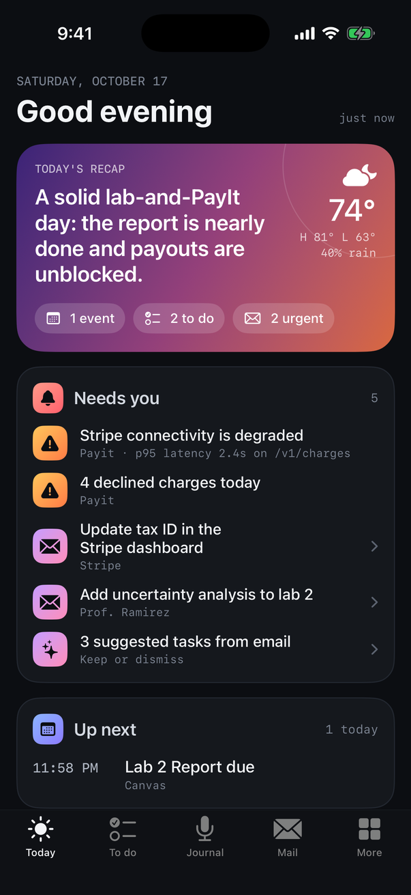
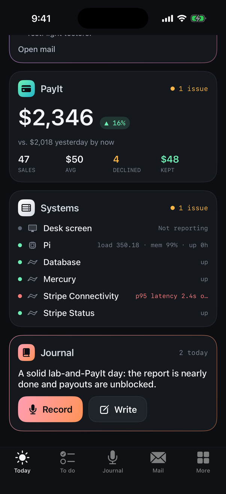
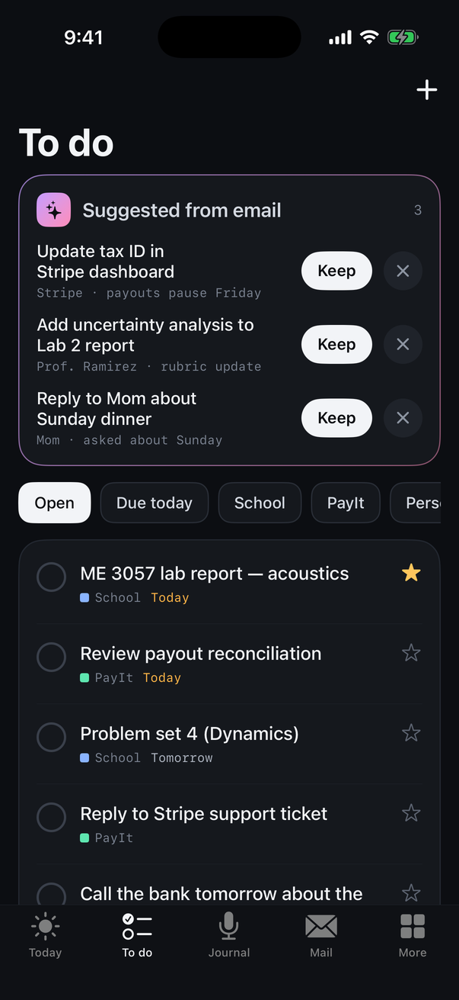
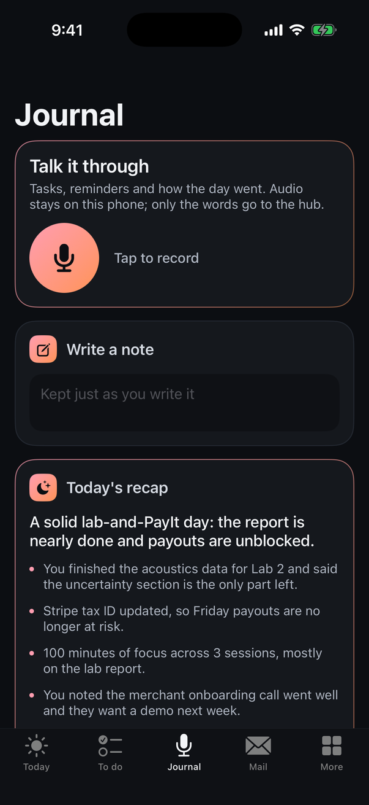
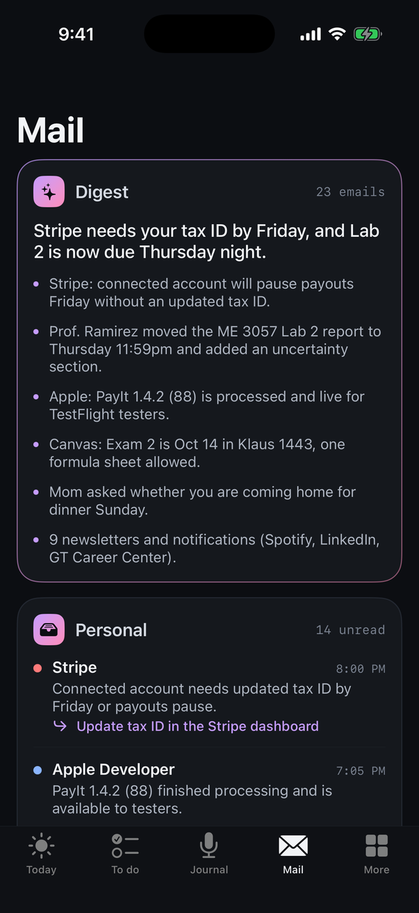
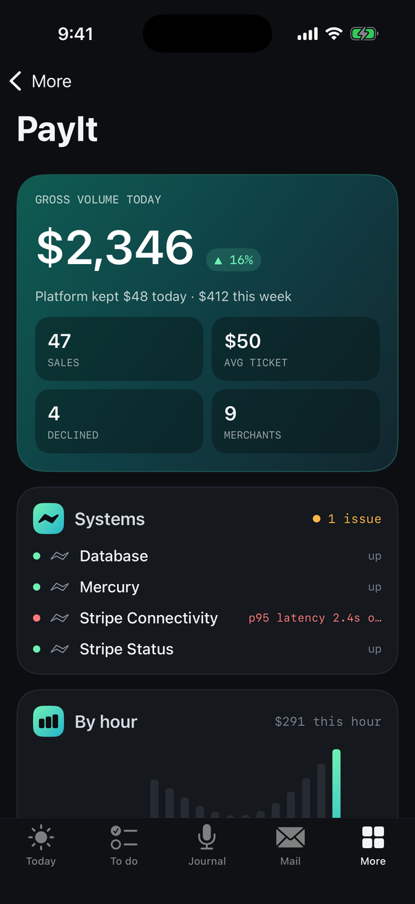
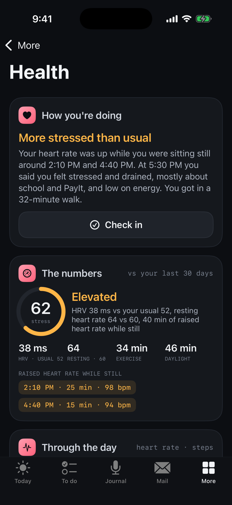
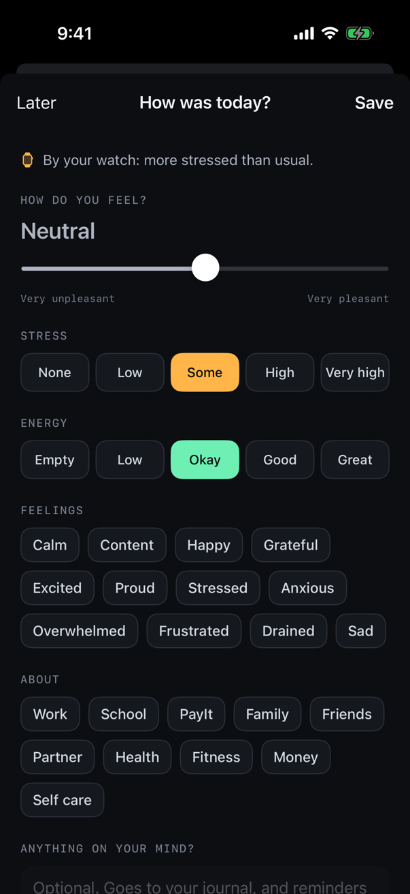

# Desk Hub for iPhone

A private iPhone app for the hub: the one place to see what's going on with your day, PayIt and your systems.

- **Today:** Claude's brief (or the evening recap), the weather, what needs you (alerts, urgent email, overdue tasks, suggestions), what's next on the calendar, today's tasks to tick off, the mail digest, PayIt, your systems (desk screen, Pi, PayIt checks, data feeds, the ring), and the journal.
- **To do:** every task, filtered by tag or due date, with steps, stars, and the tasks Claude suggested from email to keep or dismiss. Add tasks with a tag and due date.
- **Journal:** tap to talk and say how the day is going; it's transcribed on the phone with Parakeet and the hub sorts it into tasks, notes and reflections, the same as a note from the ring. Or type a note. Today's entries, Claude's recap, and every past day, searchable.
- **Claude:** your Claude chats on the Mac (from the Desk Hub Mac app): a card on Today while any are working, waiting on you or unread, and the full board in the Claude tab (its badge counts chats waiting on you or unread). Each chat shows what it's doing or waiting for, in its project's colour. Tap one and it opens on the Mac. While the app is open, a chat that finishes or needs you takes over the screen, with a haptic.
- **Mail** (in More): the digest, and each unread email in one line with what to do about it. Open one for the summary, make it a task, mark it done, or read the whole thing. Nothing is sent or marked read.
- **How you're doing:** with Apple Health connected, the app follows your Apple Watch through the day and estimates how stressed you are compared with your own normal, flags stretches where your heart rate was up while you were sitting still, and asks for a one-minute check-in every evening (mood, stress, energy, what it was about, and a note you can say out loud). Today tells the day in a few plain sentences ("More stressed than usual. Your heart rate was up while you were sitting still around 2:10 PM…"); the numbers are on the Health page if you want them. The summary goes to the hub, and Claude's evening recap can mention how the day felt. Sleep isn't used.
- **More:** PayIt in detail (by hour, last 7 days, payment methods, subscriptions), the schedule, systems and alerts, Apple Health (the day by hour, activity, check-ins, reminder settings), the ring, the hub connection, and the full hub page.
- **The ring stays with the Pebble app.** Hold the button, speak, let go: the Pebble app sends the note to the hub's webhook (`/api/voice`) and the hub files it. This app leaves the ring alone, because two apps taking turns with one ring made it flaky. More → Ring & voice notes has the webhook URL to paste into the Pebble app, with a copy button.
- **Ring clicks and music:** the Pebble app's click actions (play/pause, next track) do nothing on iPhone, and there's no way for it to run a Shortcut. For music, use a Shortcut on the phone itself: make a shortcut with **Play/Pause** (and one with **Skip Forward**), then Settings → Accessibility → Touch → **Back Tap** (or Settings → Action Button) to run it. That's instant and needs no Spotify sign-in. Prefer the ring? More → Ring & voice notes → *Connect the ring in this app instead* pairs it to this app, where a double click plays and pauses and a triple click skips in Apple Music, but then the Pebble app can't use the ring.
- **Desk Hub widget:** weather, PayIt and stress in one, on the home screen (small, long and large) and PayIt on the lock screen. Weather and PayIt come from the hub (it asks every 15 minutes or so, and the app hands it fresh numbers whenever you use it); stress is today's Apple Watch estimate, or your latest check-in when the watch has none. Press and hold it, tap Edit Widget and pick a Style: Aurora (violet and teal glow, frosted panels), Graphite (near-black, like the hub's screen) or Sky (follows the weather and time of day). Away from your home Wi-Fi it shows the last numbers it had, marked with the time. Tapping it opens PayIt.
- **Evening check-in:** a reminder at 6 PM (change it in More → Health) that opens a check-in. Talk for a minute with the questions on screen (how you feel, how stressed, how much energy, what it was about, anything to do), or tap it in. What you say is turned into text on the phone, read for mood, stress, energy, feelings and topics, and filled into the form for you to check; anything it only guessed is marked. Your words go to the hub like a voice note, so "remind me to…" becomes a task.

Nothing is published anywhere. You build it from this repo and install it on your own phone.

<p>








</p>

*From the simulator, running against the hub's demo data (`npm run demo`).*

## Install it

You need a Mac. Pick one of these.

**A. Xcode (works with a free Apple ID)**

1. Install Xcode from the Mac App Store, then in Terminal: `brew install xcodegen` and `brew install --cask temurin` (Java, which builds the ring part).
2. From the repo: `bash ios/setup.sh`. The first run takes a few minutes.
3. Open `ios/DeskHub.xcodeproj`. Under **Signing & Capabilities**, set **Team** to your Apple ID (add it in Xcode → Settings → Accounts if it isn't listed). If Xcode says the bundle ID is taken, run `BUNDLE_ID=com.yourname.deskhub bash ios/setup.sh` and reopen.
4. Plug in the iPhone, turn on **Developer Mode** (Settings → Privacy & Security), pick the phone at the top of Xcode and press **Run**.
5. With a free Apple ID, the first launch asks you to trust the app: Settings → General → VPN & Device Management → your Apple ID → Trust.

With a free Apple ID the app stops opening after 7 days; plug in and press Run again. With the $99/year Apple Developer Program it lasts a year, and it can be set up to arrive through TestFlight instead.

**B. No Xcode:** pushes to `main` that change `ios/` (or a manual run of the workflow) build the app on a Mac in GitHub Actions. Open the repo's **Actions** tab → **iPhone app** → the latest run → download **DeskHub-unsigned-ipa**, and install it with [Sideloadly](https://sideloadly.io) or AltStore, which sign it with your Apple ID. Same 7-day limit with a free Apple ID.

## TestFlight: no cable, no 7-day expiry

With a paid Apple Developer team the app installs and updates through the TestFlight app, the builds last 90 days, and just for you (internal testing) there is no App Review. One-time setup, in a browser, signed in as an **Admin or Account Holder** of the team:

1. **Team ID:** developer.apple.com → Account → Membership details → *Team ID* (ten characters).
2. **API key:** App Store Connect → Users and Access → Integrations → App Store Connect API → generate a key with **Admin** access. Download the `.p8` file (Apple only lets you once) and note the *Key ID* and *Issuer ID* at the top of the page.
3. **On this Mac:** put the file at `~/.appstoreconnect/private_keys/AuthKey_<KeyID>.p8`, and make `~/.appstoreconnect/desk-hub.env` containing
   ```
   TEAM_ID=...
   ASC_KEY_ID=...
   ASC_ISSUER_ID=...
   ```
4. **Register the app:** run `bash ios/scripts/testflight.sh` once. It will build, then fail at the upload because the app doesn't exist in App Store Connect yet; on the way Xcode registers `com.tomtech04.deskhub`, its widget and the shared storage group for your team.
5. **Create the app:** App Store Connect → Apps → **+** → New App. Platform iOS, bundle ID `com.tomtech04.deskhub`, any SKU. The *name* has to be unique across the whole App Store (even for an app nobody else can install), so use something distinctive like "Desk Hub (Tomas)"; the name under the icon on the phone stays "Desk Hub".
6. **On the iPhone:** install TestFlight from the App Store, signed in with the Apple ID that is a user on the team.
7. Run `bash ios/scripts/testflight.sh` again. After Apple finishes processing (usually 10 to 15 minutes) the build appears in TestFlight; tap Install. From then on, each update is that one command.

`bash ios/scripts/testflight.sh --archive-only` checks that the app builds and archives, with any team, without uploading.

## Set it up

1. **More → Hub connection:** the hub's address (`http://deskhub.local:8080` at home, or its public address so it works from anywhere). If the hub has `HUB_PASSWORD` set, sign in there; you stay signed in for 30 days. Voice notes you record in this app go through that sign-in. The voice token (`HUB_VOICE_TOKEN` from the Pi's `.env`) is for the Pebble app's webhook; adding it here too lets the page copy it for you.
2. **Parakeet** downloads by itself the first time (about 500 MB, so be on Wi-Fi). After that it runs offline on the phone's Neural Engine. It reads your journal recordings and spoken check-ins.
3. **Ring notes:** in the Pebble app open your ring, then Settings → **Webhook**. Paste the URL and token from More → Ring & voice notes (the token goes in the Authorization header). Hold the ring's button and speak: the note appears in the hub's Journal. The hub is only reachable on your home Wi-Fi unless it has a public address.
4. **Desk Hub widget:** press and hold the home screen, tap the **+** (or Edit → Add Widget), choose **Desk Hub**, pick a size and Add; Edit Widget changes the style. It needs the hub address from step 1, and one visit to the app on your home Wi-Fi.
8. **Evening check-in:** allow notifications when iOS asks. The reminder is at 6 PM; More → Health has the time and an off switch. The first time you talk, the speech model has to be downloaded (step 2).
9. **Apple Health:** tap **Connect Apple Health** on Today and allow everything iOS lists, then allow notifications. The evening reminder is at 9 PM; change it or turn off the "stress looks high" questions in More → Health.

## Apple Health and the stress estimate

Apple doesn't give apps a stress number, so the app makes an explainable one from what the watch records, always compared with your own last 30 days:

- **Heart-rate variability (HRV)** tends to drop when you're stressed. The watch measures it a few times a day on its own (more if you use the Breathe app).
- **Resting heart rate** tends to rise.
- **Raised heart rate while still:** 10 or more minutes at 25+ bpm over your resting rate with almost no steps and no workout. These stretches are listed on the card, and when one has just ended the app can ask how you're doing (at most twice a day).

50 is a typical day for you; above 60 is elevated, above 75 high. For the first few days, until it has enough history, it says it's still learning your usual. It's an estimate, not a medical measurement, and your own check-ins count for more. Check-ins are also saved to Health as State of Mind (iOS 18).

Read: heart rate, resting heart rate, HRV, steps, active energy, exercise minutes, stand hours, time in daylight, mindful minutes, workouts. Only the summary, the day's totals, the stress estimate and your check-ins go to the hub (`POST /api/health`), never raw samples. A check-in note is filed in the journal like a voice note. iOS wakes the app when the watch syncs new heart data, so it keeps up in the background; Apple decides how often, usually within the hour.

**If Xcode won't sign the app after this update** with an error about HealthKit, your Apple ID's free team can't use it: either join the Apple Developer Program, or remove the `entitlements:` block from `project.yml` and rerun `setup.sh` (everything else keeps working; Health stays off).

## Good to know

- **Notes from the ring are read on the phone first and sent second.** If the hub can't be reached (you're away, or not signed in), each note still gets transcribed and waits as "Transcribed, not sent yet" with the reason; they're sent the next time the app opens or the network changes. Before this was fixed, one failed send stopped the notes behind it from even being transcribed.

- **The widget can only reach the hub on your home network** (or wherever its address works). On iPhone, the widget and the app share the hub's address and your sign-in through an App Group, which free Apple IDs are allowed to use. If the widget stays on "No numbers yet", open the app once on the home Wi-Fi.
- **Spoken check-ins are read on the phone.** The words come from Parakeet, then mood, stress and energy come from what you said: numbers ("stress was a 4", "7 out of 10") and phrases ("exhausted", "wasn't a bad day") first, and Apple's on-device language model only for a level you didn't say, marked "my guess". Feelings and topics come only from words you said, so nothing is tagged that you didn't mention. Without Apple Intelligence it still works, just with the keyword rules alone.

- **If you connect the ring in this app** (the Advanced switch), the first sync clears recordings still on the ring, as the Pebble app does when pairing, and the Pebble app stops getting notes. Firmware updates always need the Pebble app: Core Devices' server answers only to a signed-in Core Devices account.
- **Clicks take a moment** (in-app ring only): the ring waits to see whether another click follows before it reports one. If a click does nothing, **Ring log** says what the app heard and what the Music app answered.
- **Battery** (More → Ring & voice notes, and the Systems card) is a percentage the app estimates, since the ring only reports a voltage and its battery can't be charged: the lower of what the voltage says and how much of Pebble's 12 to 15 hours of recording the ring has used.
- iOS wakes the app when the ring has something. If you force-quit it (swipe it away), open it once to start listening again.
- **Something not working?** More → Ring & voice notes → **Ring log** has what the ring and the app did. The share button sends it anywhere.

## How it's built

- `RingKit/` is a small Kotlin library around `io.github.coredevices.haversine`, the ring's Bluetooth library from Core Devices' open-source Pebble app ([coredevices/mobileapp](https://github.com/coredevices/mobileapp)), published on Maven Central under Apache 2.0. Its Bluetooth code ships compiled, so RingKit makes the same calls the Pebble app makes (scan, transfer, decode) rather than reimplementing the protocol. It hands each finished recording to Swift as 16-bit PCM.
- `DeskHub/` is the SwiftUI app. Pairing is CoreBluetooth: writing to the ring's encrypted characteristic makes iOS show its pairing prompt, as the Pebble app does. Speech to text is NVIDIA's Parakeet TDT 0.6B v3 through [FluidAudio](https://github.com/FluidInference/FluidAudio) 0.17.4 (Core ML).
- `project.yml` describes the Xcode project (XcodeGen), so there's no `.xcodeproj` in git; `setup.sh` builds RingKit and generates it.
- `DeskHub/` talks to the same JSON API as the hub's own screens (`/api/dashboard`, `/api/todos`, `/api/journal/*`, `/api/mail/*`), with the hub's session cookie when it has a password. Notes spoken into the phone go to `/api/voice` marked as coming from the phone. The Health day goes to `/api/health` (session cookie, or the voice token from the background).
- `HealthMonitor.swift` reads Apple Health with HealthKit's async queries, `StressModel` makes the estimate, and `HKObserverQuery` with background delivery wakes the app for new heart data. `-healthDemo YES` on launch shows sample data instead, for the simulator.
- `scripts/screenshots.sh` boots an iPhone simulator, points the app at a hub on the same Mac (`npm run demo`), and screenshots every screen.
- `.github/workflows/ios.yml` does all of that on a GitHub Mac runner: it builds the app, runs it in the simulator against the hub's demo data, and keeps the screenshots under the run's Artifacts. In a private repo those minutes count 10× against the free Actions allowance, so it only runs when `ios/` changes.
